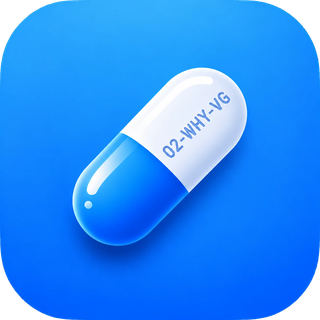
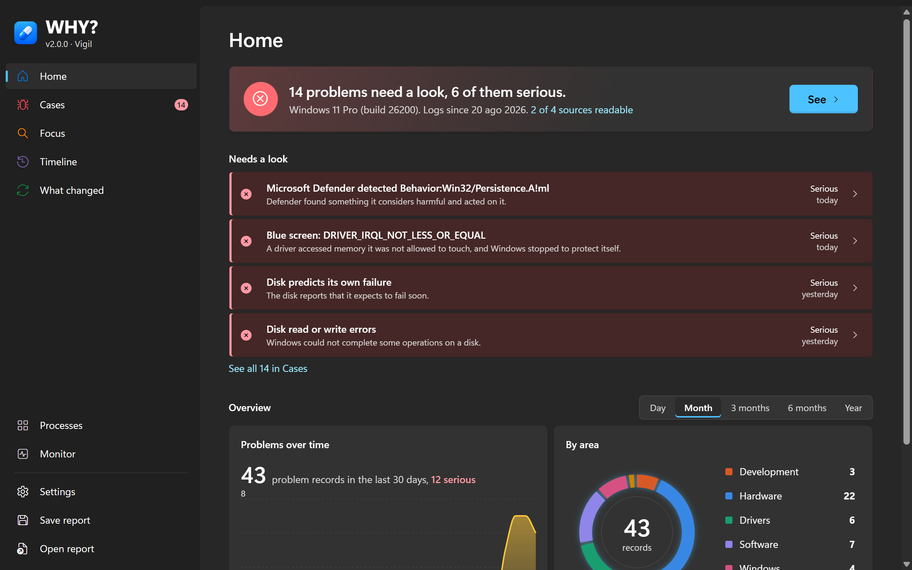
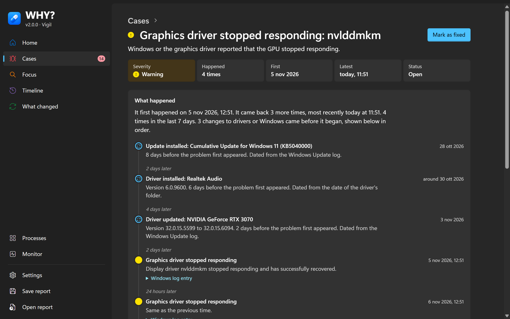
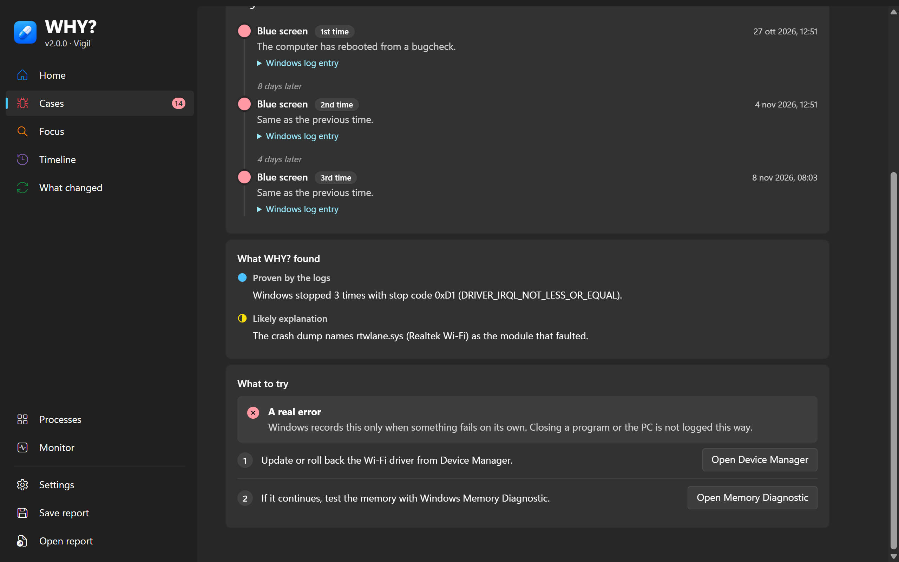
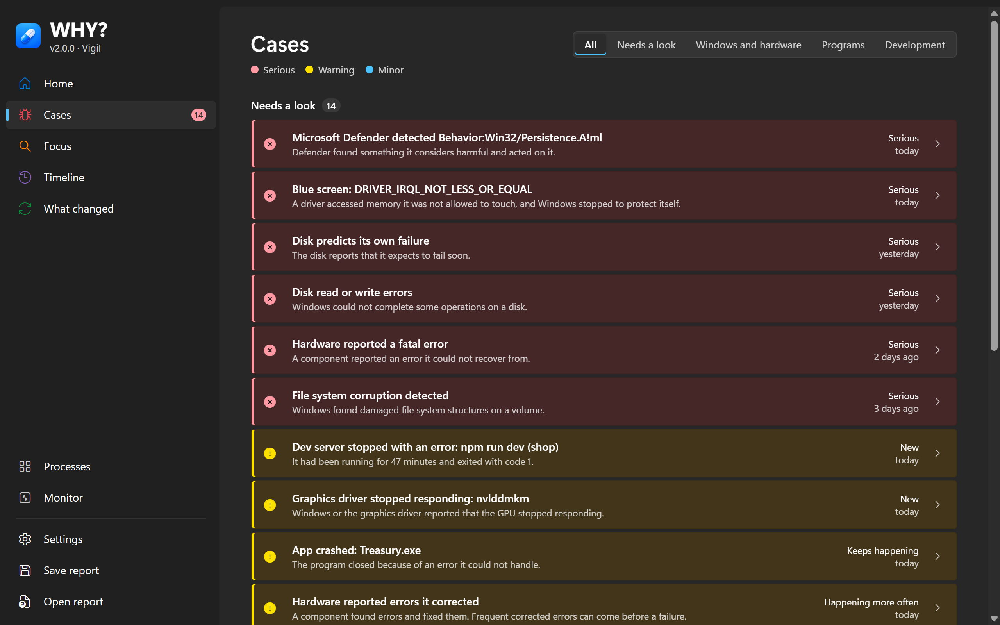
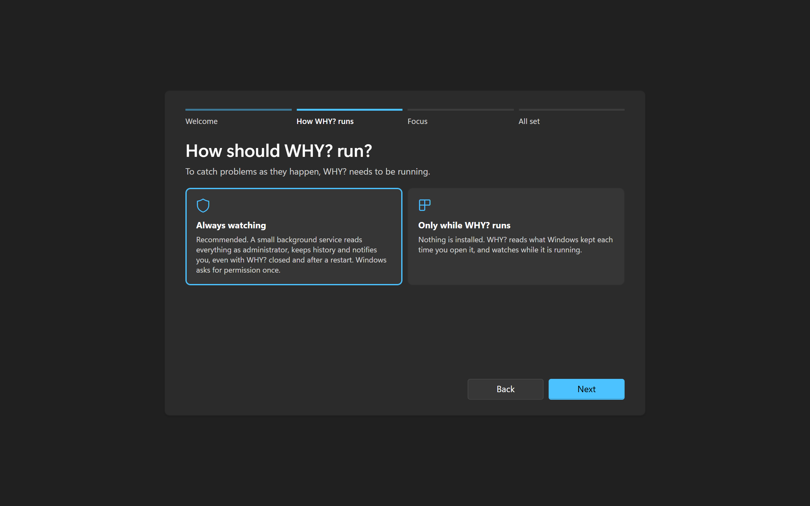

<p align="center">
  
</p>

<h1 align="center">WHY?</h1>

<p align="center">
  <strong>Your PC crashed. Your build failed. Now you know WHY.</strong>
</p>

<p align="center">
  WHY? is a Windows app that reads what Windows records about every crash, freeze and failure, and turns it into a short, plain answer: what happened, what most likely caused it, and what to do about it.
</p>

<p align="center">
  
  
  
  
  
</p>

<p align="center">
  <a href="#get-why">Download</a> ·
  <a href="#what-why-does">What it does</a> ·
  <a href="#why-for-developers">For developers</a> ·
  <a href="#why-you-can-trust-it">Privacy</a> ·
  <a href="#build-why-yourself">Build</a>
</p>



## The problem WHY solves

When something goes wrong on a Windows PC, Windows almost always writes down what happened: a blue screen leaves a stop code and a crash dump, a crashing program leaves an error report, a failing disk leaves warnings, a driver update leaves a date. The answer usually exists. It is just spread across thousands of log entries, in tools like Event Viewer that few people open and fewer can read.

So the question stays the same: *WHY did that happen?*

WHY? reads those records for you, connects the ones that belong together, and shows each problem as one clear **case**.

## What WHY does

| | Step | What you see |
| --- | --- | --- |
| 1 | **Notices** | Blue screens, sudden restarts, crashing and frozen programs, driver and disk errors, hardware warnings, Microsoft Defender detections, and failing dev servers and builds. |
| 2 | **Groups** | Every occurrence of the same problem becomes one case, with how often it happened and whether it is getting worse. |
| 3 | **Explains** | What happened in plain words, what changed on the PC before it began, and how sure WHY? is about each statement. |
| 4 | **Tells you what to do** | Whether it was a real error or something closed by force, then concrete fixes for that specific problem. |



### WHY? says how sure it is

A tool that guesses with confidence does more harm than no tool. Every statement in a case carries one of three levels, so you know what is fact and what is a lead:

- **Proven by the logs:** Windows recorded it directly.
- **Likely explanation:** direct evidence points to it, such as the driver named in a crash dump.
- **Around the same time:** it happened nearby, which on its own proves nothing.

When the evidence is not enough to name a cause, the case says so instead of inventing one.

### Real error, or closed by force?

Not every red line in a log is a fault. A program you ended from Task Manager, a PC switched off with the power button, a command stopped from outside: these look like failures but are not. Each case answers this first, because it decides whether there is anything to fix:

- **A real error:** it failed on its own, for example a crash, a blue screen or a disk error.
- **A forced closure:** it was ended from outside, so there is nothing to repair.
- **Not certain:** the logs cannot tell the two apart, and the case explains why.



### All your cases in one place

Cases are coloured by severity, with the same status icons Windows 11 uses: red for serious, yellow for warnings, blue for minor ones. The ones that need your attention come first. Mark a case as fixed once you have tried something: WHY? keeps watching and tells you if it comes back.



## WHY for developers

When the program that crashes is the one you are writing, WHY? watches that too.

- **Dev servers and builds.** Node, Bun, Deno, Python, .NET, Java, Go, Cargo, Ruby and PHP processes that exit with an error become cases: a dev server that stops after running for a while, or a build or test run that fails. Ctrl+C is not counted. A failed build or test is listed as minor and never interrupts you; a real crash, such as `0xC0000005`, is a warning.
- **The error it printed.** WHY? cannot read a terminal it did not start. Start a command through `why-run` and the end of its error output is kept and shown in the case, whether or not WHY? was open:

  ```powershell
  why-run npm run dev
  why-run python -m uvicorn main:app --reload
  ```

  The command runs exactly as before, with its colours and shortcuts. why-run is a separate program because `why.exe` is a window app, and a terminal neither waits for it nor shows its output.
- **Focus.** Point WHY? at one program, or at a folder you develop in, and it shows and notifies only the crashes and hangs of what you are building, not the rest of Windows.

## Get WHY

Download the latest version from [**Releases**](https://github.com/DevToccus/WHY/releases/latest):

| File | What it is |
| --- | --- |
| `why.exe` | The app. Portable: it runs as it is, nothing to install. |
| `why-run.exe` | The wrapper for dev commands. Put it on your PATH to use it from any folder. |
| `WHY-v<version>-<code name>.zip` | Both programs and this README, ready to unpack. |
| `SHA256SUMS.txt` | Checksums of every file. |

**Requirements:** Windows 10 or 11, 64-bit, with the Microsoft Edge WebView2 Runtime, which Windows 11 already includes. The programs are not signed yet, so SmartScreen may warn the first time they run. The "Source code" archives GitHub adds to every release hold the source, not the programs.

### First run



WHY? asks once how it should run. You can change it later in Settings.

- **Always watching** (recommended): a small background service reads everything with administrator rights, keeps history and notifies you, even with WHY? closed and after a restart. Windows asks for permission once.
- **Only while WHY? runs:** nothing is installed. WHY? reads what Windows has kept each time you open it, and watches while it is open. You choose whether it runs as administrator, starts with Windows and stays in the notification area.

Without administrator rights WHY? still reads the Windows logs and the driver list. Crash dumps, the file change journal and the activity recorder need them, and Settings shows what is missing.

## WHY you can trust it

- **It changes nothing.** WHY? only reads. It never deletes, repairs, disables or blocks anything. Even "Mark as fixed" is just a note to itself.
- **It stays on this PC.** No account, no cloud, no telemetry. The interface is embedded in the program and cannot load anything from the internet.
- **Reports are anonymous.** A saved report removes account and computer names, so you can send it to a technician or a friend.
- **The service is locked down.** It runs from `%ProgramFiles%\WHY`, which normal users cannot write to. Its history in `%ProgramData%\WHY` is readable only by SYSTEM and administrators, and the app talks to it through a local pipe with no network access.

## What WHY covers

| Area | Problems |
| --- | --- |
| Windows | Blue screens, restarts without a clean shutdown, services that stop unexpectedly |
| Drivers | Graphics driver resets, drivers that fail to load, driver changes before a problem began |
| Hardware | WHEA hardware errors, disk errors and predicted failures, storage resets, file system corruption |
| Programs | Crashes and freezes, with the module that failed |
| Security | Microsoft Defender detections, threats it could not remove, real-time protection turned off |
| Development | Dev servers that stop with an error, failed and crashed commands |

**Sources it reads:** the System and Application logs, crash dumps (read locally with the debug engine built into Windows, never downloading anything), the installed drivers, Windows Update history, the NTFS change journal for driver files, and a recorder of process starts, stops and driver loads.

**Not covered yet:** boot time, network problems, performance, disk health readings, CPU temperature.

### Other ways to run it

| Mode | Command | What it does |
| --- | --- | --- |
| App | `why.exe` | Reads and watches, as described above |
| Report | `why collect --out report.whyreport.json` | Same reading, no window, saves a report |
| Read a report | `why report.whyreport.json`, or **Open report** | Shows a report saved on another PC |
| Service | `why service install`, as administrator | The same as choosing Always watching |

`why.exe` is a window program, so a command prompt does not wait for it: use `start /wait why collect ...` in scripts.

## What's new in Vigil

- **Always watching.** Live monitoring is now the first choice in setup and in Settings: a background service reads everything as administrator, keeps history and notifies you, even with WHY? closed.
- **Cases by severity.** Every case is coloured by how serious it is, with the Windows 11 status icons, and cases that need a look come first.
- **Cases you can filter.** Needs a look, Earlier and minor, and Marked as fixed, filterable by Windows and hardware, Programs or Development.
- **What happened, in words.** Each case opens with its key facts and tells its story: when it began, how often it came back, what changed before it.
- **Real error or forced closure.** Each case says which it was, then lists concrete fixes for that problem.
- **Fixes that hold.** A case marked as fixed stays fixed when its details shift. If it really comes back, WHY? says so.
- **Quieter failed commands.** A build or test run that exits with code 1 to 255 is minor and never asks for attention.
- **Opens reliably after sign-in.** The window no longer appears blank when WHY? was started hidden at sign-in.
- **why-run in every download**, and a new icon.

Every version has a code name and its own release. [VERSIONS.md](VERSIONS.md) lists them and explains how to get a specific one.

## Build WHY yourself

<details>
<summary>Building, tests and project layout</summary>

Needs Visual Studio 2022 Build Tools with the C++ workload and the Windows SDK, plus Node.js. vcpkg, bundled with Visual Studio, fetches the C++ libraries.

```powershell
npm --prefix ui install
pwsh scripts/build.ps1                                   # Release build in build/release
pwsh scripts/build.ps1 -Preset asan -Target why_tests    # Tests under AddressSanitizer
```

```powershell
build/release/why_tests.exe   # Rules, parsers, investigation, storage, fuzzing
build/release/why_probe.exe   # Runs every Windows source on this PC; run elevated for full coverage
```

To work on the interface alone, `npm --prefix ui run dev` serves it with invented sample data at `http://localhost:5199`. Add `?real` to read a report copied to `ui/public/dev-state.json`. The screenshots in this README use that sample data.

```
src/core     Logic with no Windows dependency: event parsing, the signal table, the investigator, storage
src/collect  Windows data sources
src/engine   The engine that runs them, the local pipe and the service
src/app      Entry point, WebView2 window, tray notifier, performance monitor
src/run      why-run, the console wrapper for dev commands
ui           React interface, built into one HTML file embedded in why.exe
tests        Unit and fuzz tests, and the probe
docs/images  Screenshots for this file
```

The signal table in `src/core/signals.cpp` decides which Windows events matter; anything not listed is ignored. An event ID only counts together with its provider, because different providers reuse the same numbers.

</details>

---

<p align="center">
  Stop asking <em>why</em>. Ask WHY.
</p>
